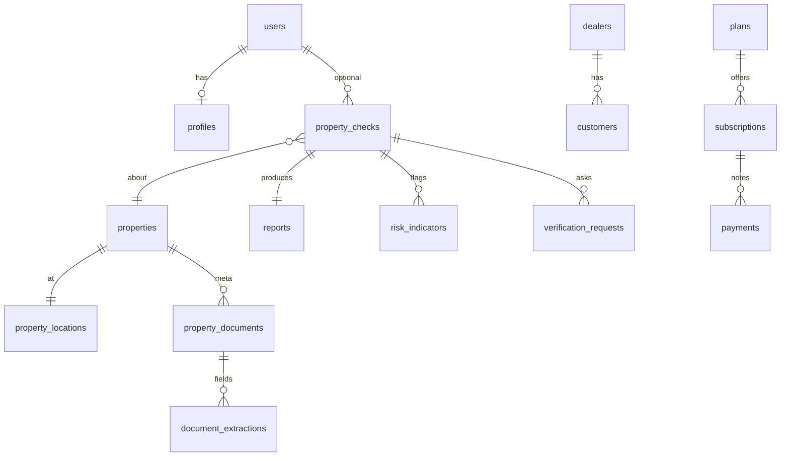

# START NOW — Architecture

**Inspect first. Do not start coding immediately. Do not add features only to look large** (`docs/SCOPE.md`).

This repository is already a working Next.js PWA due-diligence product with optional Django/Postgres. Phases 3–17 are in tree (`docs/DEVELOPMENT.md`). New work **extends** these folders — it does not start a second app, Vite rewrite, or Flutter MVP.

Machine map: `src/lib/process/start.ts`.

---

## 1. Current repository analysis

| Layer | What exists |
| --- | --- |
| Product | PropertyCheck Pakistan — due diligence / decision support, not listings/CRM/chatbot/marketplace |
| Frontend | Next.js **16.3.3** App Router (`src/`), React 19, Tailwind 4, TanStack Query, Zod, Vitest, Puppeteer e2e |
| Backend | Optional Django+DRF (`api/`) + Postgres; Next `/api/*` is the browser origin (`connect-src 'self'`) |
| Local without Django | Shared reports as JSON under `./data/checks` |
| Compose | `docker-compose.yml` — nginx, web, api, Postgres 16, MinIO |
| Languages | Roman Urdu default + Urdu + English |
| Hard rules | Guest `/check` needs no account; papers on-device only; never invent land-record APIs; never mark legally **Verified** without official/professional confirmation through the platform |

**Home CTAs (only four):** `/check`, `/token`, `/dealer`, `/how`.

---

## 2. Proposed architecture

```
Phone / browser (PWA)
  ├─ Wizard + OCR (tesseract, on-device) + risk engine
  ├─ Encrypted paper photos (IndexedDB)
  └─ fetch same-origin /api/*  (CSP connect-src 'self')
        ├─ Next route handlers (auth, checks, admin, billing, ai…)
        └─ optional proxy → Django /v1/* + Postgres + object store (JSON only)
```

UI stays thin (`src/components`). Domain logic lives in `src/lib/*`. Django owns normalized tables when `DJANGO_API_URL` is set.

---

## 3. Database ERD

Contract: `src/lib/db/schema.ts`. Models: `api/checks/models.py`.



**Never store:** paper photos/blobs, raw share keys, full CNICs, card PAN/CVV, plain passwords, sales CRM pipeline fields.  
**Allowed:** `share_token_hash`, CNIC last-4, password hash, document metadata + `image_print`.

Guests do not need a `users` row.

---

## 4. API architecture

| Surface | Role |
| --- | --- |
| `/api/auth/*` | Optional register/login/session/TOTP/account |
| `/api/checks` | Shared JSON report only (reject paper dumps) |
| `/api/reviews` | Professional review requests |
| `/api/admin/[section]` | Granted staff desks |
| `/api/billing/*` | Plan catalog / entitlements (no card processor) |
| `/api/ai/explain` | Optional evidence restatement |
| `/api/analytics`, `/api/errors`, `/api/complaints` | First-party ops |
| `/api/official/status` | Official slots — currently none live |
| `/api/geo/search` | Location assist |
| `/api/health` | Health |
| `/v1/*` | Django: health, checks, billing plans, rule classify/explain |

No live government land-record HTTP clients.

---

## 5. User journeys

1. **Guest check** — `/check` → answers → optional paper OCR → review fields → report → optional share `/r/[id]?k=` (hash only on server).
2. **Token** — `/token` checklist → `/check?intent=token`.
3. **Dealer** — `/dealer` information page → upload → report → WhatsApp share with customer (not a CRM).
4. **Understand** — `/how`, glossary, offices.
5. **Overseas** — `/overseas` → `/check?intent=buy&abroad=1` (path guidance, not certified POA).
6. **Mine** — device-saved checks (`/mine`).
7. **Professional review** — `/review` when entitled.
8. **Staff** — `/admin` with scoped grants (owner unlimited only).

---

## 6. Folder structure

```
src/app           pages + /api
src/components    wizard, report, dealer, admin, share
src/lib           engine, docai, ai, offline, billing, server, i18n, …
api/              Django checks + intelligence + /v1
infra/nginx       reverse proxy
public/           sw.js, offline.html, ocr assets
docs/             architectures, testing, quality, scope
data/             local JSON/JSONL (gitignored payloads)
scripts/          e2e + vendor-ocr
```

---

## 7. Security model

- HTTPS in production; HttpOnly session cookie; CSRF origin checks; rate limits; audit JSONL.
- Roles: `guest | member | professional | staff`. Professional/staff 2FA.
- Staff desks by grant — not unlimited (except owner bootstrap).
- CSP: `connect-src 'self'`; papers encrypted on device; share keys never stored.
- Secrets only via env (`.env.example`); never commit `.env` / API keys / DB credentials.
- Guest errors never leak TypeError / raw 500 phrasing.

---

## 8. AI architecture

```
Paper (on device) → OCR text → classify → extract → compare → risk/evaluate → grounded explain
                                                                      ↓ optional
                                                              LLM_EXPLAIN_URL restatement
                                                              (drop if invents facts)
```

App does **not** require an LLM. Django `/v1/ai/classify/` is rules-only. Missing evidence: “I don't have enough information to determine this.” No LLM verdict. No fraud accusation from duplicates.

---

## 9. Offline / PWA strategy

- Manifest + `public/sw.js` (precache shell; **skip `/api/`**).
- Drafts / checks in `localStorage`; photos in IndexedDB (encrypted).
- Sync phases: saved on device → offline → syncing → synced/failed (`src/lib/offline`).
- Low-bandwidth / rural toggles; compress before OCR.
- Guest can start a check with no account, including weak networks.

---

## 10. MVP scope (ship / already in tree)

Safer, easier, clearer, more accessible buy/sell support:

- Guest property check → on-device papers → risk/report → WhatsApp-friendly share
- Token checklist, dealer information pages, overseas path, offices/glossary
- EN / Urdu / Roman Urdu; PWA + low-bw; optional auth + staff desks
- Configurable plans (manual notes — no card vault)
- Rules explain + optional LLM hook
- Docker Compose + CI + tests

**Out of MVP:** marketplace, CRM, chatbot, Flutter app, invented government APIs, “legally Verified” without official/professional confirmation.

---

## 11. Phase 2 scope (only if the filter passes)

Partner-backed work that improves safety/clarity — not portfolio padding:

- Real **authorized** official verification adapters when partners exist (`src/lib/official` slots) — never fake APIs
- Unify production identity/persistence (Postgres path as default in deploy)
- Billing ops hardening (still no unnecessary card vault unless required)
- Deeper professional review workflows
- Performance / a11y / security hardening from production metrics

---

## 12. Phase 3 scope (after web validation)

- Flutter client **only after** web product is validated
- Broader partner network (banks, legal, verification partners) on the same due-diligence contract
- Stronger analytics (still privacy-conscious — counts, not CNIC/papers)

---

## After each major phase (gate)

1. Run tests (`npm test`, Django tests, `npm run test:e2e` when UI changes)
2. Check for errors
3. Check responsive UI (360 → desktop)
4. Check accessibility
5. Check security (secrets, CSP, papers stay local)
6. Check performance (especially OCR / low-bw)
7. Fix issues
8. Continue

Objective: a real, scalable Pakistan-focused PropTech product — not a portfolio website.
